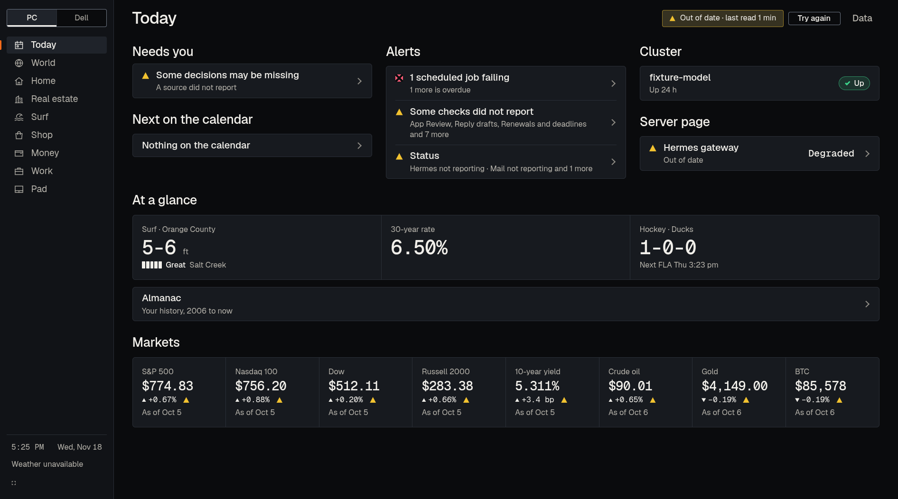
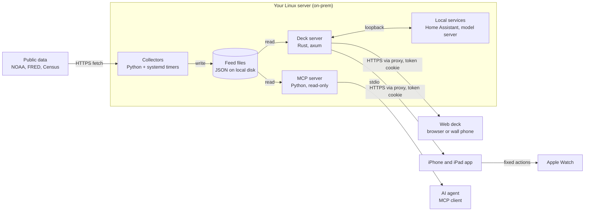

# Omarchy Deck

A self-hosted status board and touch remote for the machines you run yourself. One small Rust server on your own Linux box turns local JSON feeds into a dashboard for a browser, a wall-mounted phone, an iPhone or iPad, an Apple Watch and AI agents.



## What it needs and where data goes

- Hardware: any Linux server with systemd. It needs no GPU and no VRAM. The release binary carries the whole web UI inside it. Built and tested on x86-64.
- Data stays on the box. Collectors write JSON files to local disk. The server reads those files and talks to services on loopback or your LAN (Home Assistant, a local model server, the agent gateway).
- Outbound calls are limited to what you install: collectors fetch public data (NOAA buoys, FRED rates, Census tables). The server uses the Omarchy weather script first, then Home Assistant's forecast and Open-Meteo as fallbacks. Nothing else leaves the machine by default.
- Phones and tablets reach the server over HTTPS on your own network or VPN. Access is a token you create on the server.

If you run open models locally (for example gpt-oss or Llama on llama.cpp or vLLM), the Cluster card shows the model server's state from a feed file. The deck itself runs no model.

## Architecture



Static copy: [docs/architecture.svg](docs/architecture.svg).

## How it works

1. Collectors run on systemd timers. Each one writes a single JSON file with `t` (epoch seconds), `refresh` (period in seconds), `src` (sources it read) and `errors` (sources that failed).
2. The deck server reads those files on request, trims each to the fields its page uses, and adds `age` and `stale`. A missing or old feed shows as "Not reporting" or "Out of date", never as zero.
3. Controls (media keys, workspace switch, Home Assistant scripts) go through a fixed allowlist. The client sends an index or a name from that list, such as a key macro index or a house action with its entity id. The server refuses anything off the list before it runs a command or calls Home Assistant. Each press is rate limited and logged.
4. The Pad page is a trackpad and keyboard over a WebSocket. The server starts a small input agent per session that writes to `ydotoold` on Linux hosts or Quartz on the Mac mini.
5. The iOS app is a native shell around the same web deck. Each server gets its own WebKit data store, the token is used once to get a session cookie, and an offline sample deck works with no server.
6. The MCP server gives AI agents read-only tools over the same feed files. It never writes and never opens a network connection.

## Repository layout

| Path | What it is |
|---|---|
| `web/` | Deck server (`web/rust`), web UI (`web/static`), collectors (`web/scripts`), tests |
| `ios/` | SwiftUI app for iPhone, iPad and Apple Watch, plus a Linux test harness and an xtool package |
| `mcp/` | Read-only MCP server over the feed files |
| `samples/` | Synthetic feeds for a local run |

## Stack

- Server: Rust 2021, axum 0.8, tokio, reqwest with rustls. Plain HTML, CSS and JavaScript with no framework and no CDN; hls.js is vendored.
- Collectors: Python 3 standard library, systemd user timers.
- iOS: SwiftUI, WKWebView, StoreKit, WatchConnectivity. iOS 18 and watchOS 11 or later.
- MCP: Python with FastMCP over stdio.

## Build and run

Run the web deck on sample data:

```sh
(cd web/rust && cargo build --release)
web/scripts/run-sample.sh
# open the printed http://127.0.0.1:18796/?t=... link
```

Run the tests:

```sh
(cd web/rust && cargo test --locked && cargo clippy --all-targets --locked)
(cd web && node --test tests/*.test.js && python3 -m unittest discover -s tests && python3 -m unittest discover -s scripts/tests)
(cd mcp && python3 -m venv .venv && .venv/bin/pip install -r requirements.txt && .venv/bin/python -m unittest discover -s tests)
(cd ios && bash scripts/linux-test.sh)
```

Full steps, including the Xcode build, the Linux xtool build and production install: [BUILD.md](BUILD.md).

## Limits

- Built for one owner on one network. It is not multi-tenant, and any process running as the same user is trusted.
- Some pages expect collectors that are not in this repo (calendar, mail, finance, deadlines). Without their files those pages say "Not reporting".
- The iOS app needs a Mac with Xcode to sign and install. The Linux harness tests only the Foundation code, not SwiftUI or WebKit.
- The xtool build path was not run while preparing this repo.

## License

Copyright 2026 Tanner Osterkamp. All rights reserved. See [LICENSE](LICENSE). The source is public to read; ask before reuse. Third-party parts keep their own licenses: hls.js (Apache 2.0) and the Geist fonts (SIL OFL 1.1).
